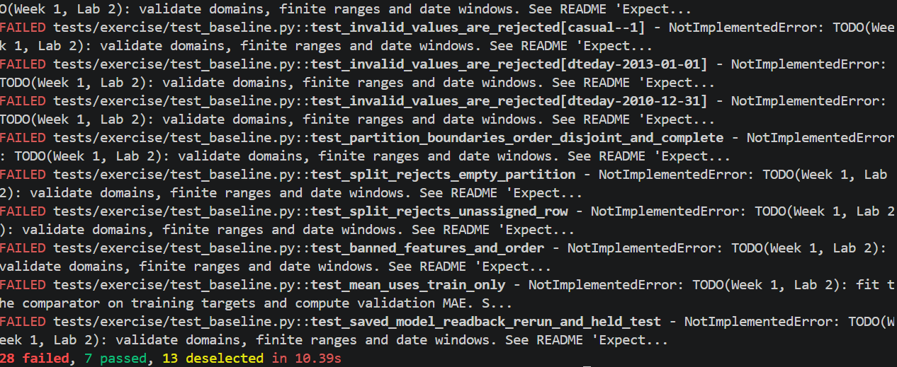
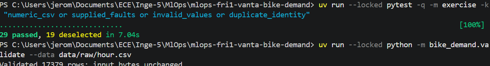
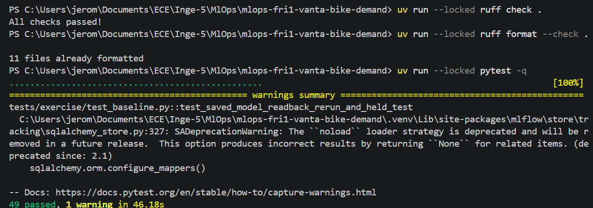
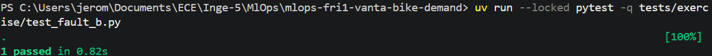
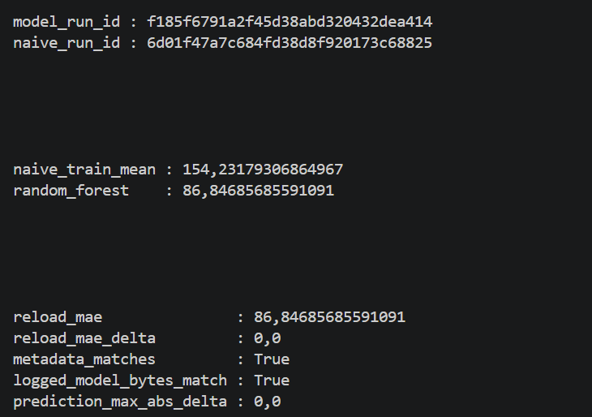

# Week 1, Labs 1–2: team evidence

## Team and roles

Team: Vanta. Members: Jeromsan JUDES RAMESH, Merwane KHELOUFI and Yvan FEUGANG.
Lab 2 roles are the same as Lab 1: Jeromsan handles the changes, local commands, evidence and screenshots; Merwane KHELOUFI is the designated reviewer. Yvan FEUGANG is the third team member. The roles have not rotated between these labs.

## Repository and pull requests

Repository: https://github.com/Jeromsan/mlops-fri1-vanta-bike-demand.
Lab 2 branch: `lab2/validated-baseline`. Lab 2 PR has not been opened yet.

## Setup, preflight and quality checks (commands and actual results)

Checks performed on 2026-10-09, with uncommitted Lab 2 changes:

- `uv run --locked python -m bike_demand.preflight`: passed.
- `uv run --locked ruff check .`: all checks passed.
- `uv run --locked ruff format --check .`: 11 files already formatted.
- `uv run --locked pytest -q`: 49 passed, 1 warning in 23.48s.

Jeromsan's final verification, shown in the screenshots below: Ruff passed, 11 files were already formatted, and all 49 tests passed with one warning in 46.18s.

The warning is a SQLAlchemy deprecation warning emitted by MLflow. No tests failed. Remote CI has not been checked for this Lab 2 revision.

## Data identity, validator checks and added test

The frozen CSV contains 17,379 rows. SHA-256: `e03de4ee4ef4dc376ac6e04bf829673c6269e8eba5c60fa121640fa2f829504f`.
Validation checks categorical integer domains, finite weather values between 0 and 1, finite nonnegative integer counts and dates within 2011–2012. Missing hours are accepted. The original CSV was not changed.

The targeted data-validation tests passed: 29 passed, 19 deselected. Initial exercise results reported by Jeromsan were 28 failed, 7 passed, 13 deselected, due to unfinished functions.
The added test `test_fault_b_infinite_count_is_rejected` checks a valid control, rejection of an infinite target count and unchanged fixture bytes after rejection.

Commands used for the validation screenshot:

```powershell
uv run --locked pytest -q -m exercise -k "numeric_csv or supplied_faults or invalid_values or duplicate_identity"
uv run --locked python -m bike_demand.validate --data data/raw/hour.csv
```

## Partition counts, boundaries and held test rows

| Partition | Rows | Start | End |
| --- | ---: | --- | --- |
| Train | 8645 | 2011-01-01 | 2011-12-31 |
| Validation | 4358 | 2012-01-01 | 2012-06-30 |
| Test | 4376 | 2012-07-01 | 2012-12-31 |

Rows are sorted by `(dteday, hr, instant)`. Partitions must be nonempty, disjoint and complete. Test rows are retained and counted; no test metrics were computed.

## Comparator and RF: run IDs, validation MAEs, metadata/readback

Training command: `uv run --locked python -m bike_demand.train --config configs/baseline.yaml`.
Execution timestamp: `2026-10-09T10:39:07.034710+00:00`.

| Predictor | Validation MAE (rentals/hour) | MLflow run ID |
| --- | ---: | --- |
| Training mean | 154.23179306864967 | `6d01f47a7c684fd38d8f920173c68825` |
| Random Forest | 86.84685685591091 | `f185f6791a2f45d38abd320432dea414` |

The training mean is 143.79444765760556. The RF uses the fixed configuration: 50 trees, depth 10, random state 42 and one worker. Only the 12 ordered calendar/weather predictors are used; labels and identities are excluded.

Model version: `baseline-df42e666d6d6`. Recorded Git commit: `3b00e6018ac416a1d7d145fe85caa0270cccd231`. `working_tree_dirty` is true: this run includes uncommitted changes and does not represent that commit alone.

Saved outputs: `artifacts/model.joblib`, `artifacts/model-metadata.json`, `reports/metrics.json` and `reports/metrics-history.jsonl`. MLflow data is stored locally under `tracking/`.
Readback passed: metadata and logged model bytes match; reloaded MAE is 86.84685685591091, MAE delta is 0 and maximum prediction delta is 0.

The Random Forest has a lower validation MAE than the training-mean comparator in this run. These are validation results only.

## Optional stretch, after the core: unchanged-config repeat (new run IDs, history, differences)

Not attempted on the course CSV. The supplied integration test verifies repeated executions using synthetic data.

## Fault diagnosis and your own Fault B

- Choice: replace one `cnt` value with positive infinity in a temporary copy of the six-row valid fixture.
- Reason: rental counts must be finite nonnegative integers; infinity would invalidate training and error measurements.
- Result: the valid control loads successfully, and the faulty copy raises `ValueError` naming `cnt`. The test passed and confirms the input bytes remain unchanged. This checks the finite-count rule, not every possible data fault.

Command: `uv run --locked pytest -q tests/exercise/test_fault_b.py`. Jeromsan's screenshot shows `1 passed in 0.82s`.

## Review observation and author's response

Lab 2 review, reviewer observation, author's response and CI results: pending. The PR and checked commit will be recorded after the review.

## Contribution and assistance/recovery acknowledgement

Jeromsan ran the initial and final checks, displayed the training results and took the screenshots. Codex helped implement the validator, chronological split, feature selection, mean comparator, RF evaluation and Fault B test, ran checks and training, and prepared this report. The team will review the changes before merging. No instructor recovery function was used.

## Blockers and next action

Local implementation, checks, training and screenshot evidence are complete. No local technical blocker remains. Next: review the diff, commit and push the branch. PR, review and CI evidence remain pending. The individual Week 1 report belongs in a separate private repository.

## Screenshots

The screenshots below show local executions before the Lab 2 commit. Exact execution commits were not recorded. The training screenshot identifies the saved MLflow runs.



Before implementation: `uv run --locked pytest -q -m exercise` reported 28 failed, 7 passed and 13 deselected in 10.39s. The failures shown are expected `NotImplementedError` messages from unfinished functions. Execution commit: not recorded.



After implementing the validator: the targeted data tests reported 29 passed and 19 deselected in 7.04s. CSV validation reported 17,379 valid rows with unchanged input bytes. The last output line is partly cropped. Execution commit: not recorded.



Jeromsan's local verification: Ruff lint passed, Ruff reported 11 files already formatted, and the full test suite reported 49 passed with one MLflow/SQLAlchemy deprecation warning in 46.18s. Execution commit: not recorded; Lab 2 changes are not committed yet.



The added Fault B test passes: `1 passed in 0.82s`. It checks a valid control, rejection of an infinite count and unchanged input bytes.



Runs `f185f6791a2f45d38abd320432dea414` (Random Forest) and `6d01f47a7c684fd38d8f920173c68825` (training mean): validation MAEs are 86.84685685591091 and 154.23179306864967. Metadata and logged model bytes match. Reloaded MAE and predictions have zero difference from the original results. The screenshot displays decimal commas because of the local PowerShell settings.

PR checks screenshot: pending until the PR is opened and CI runs.
